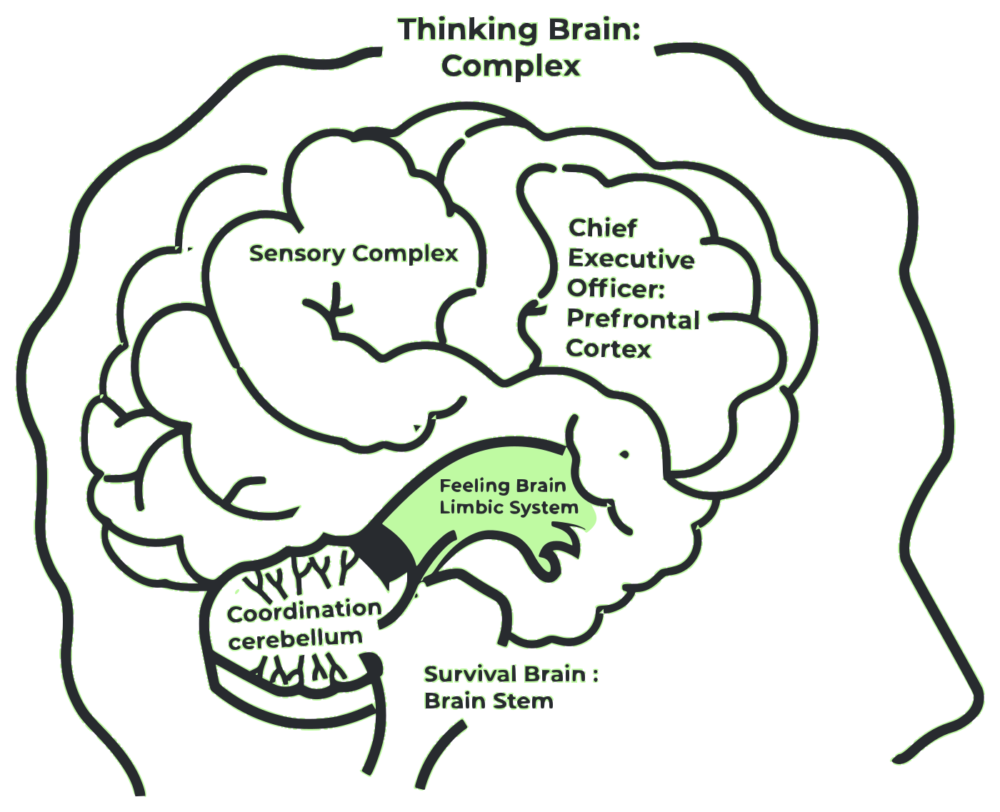

Our newsfeeds are overflowing with stories of declining mental health and education outcomes in America – and things look bleak – especially at first glance.

The current climate in education is catastrophic when it comes to the mental health of both students (children of all ages) and teachers. Stress and anxiety levels are extraordinarily high; in fact, the highest ever measured in children – and they were already alarming before the pandemic. As it stands, **the numbers are over the top, with upwards of 80% of children reporting feeling significant stress.** Students today are facing mounting challenges which contribute to their anxiety: stressors like isolation, poverty, bullying, digital distraction, and the pandemic, to name a few.

Similarly, **among teachers, we hear of escalating stress levels in the 60 to 70% range.** The stress, overwhelm, and burnout among teachers today are driving them to leave the profession in droves, with some even departing amid an academic year.

As most states now are diving into the data from last year’s testing sequence, they realize that students have lost a significant amount of ground in their academic performance and are really struggling on the mental health front. There are not enough counselors and social workers in schools, so there are very few places for children to get the support they need.

Here we have two groups suffering that may have or potentially are developing unhealthy coping mechanisms resulting from chronic stress and overwhelm. **So, is it any wonder we see anxiety disorders, stress-related disorders, depression disorders, senses of violence, self-harm, and suicidal ideation are increasing?**

Stress multiplied by stress results in overwhelm, behavioral outbursts, and more – it’s like a raging storm.

But if we shift our mindset…anything is possible…

Consider that every problem presents an opportunity to reimagine a better way forward. **There is hope on the horizon for addressing mental health in schools through implementing a mindfulness-based approach and championing teaching mindfulness in the classroom using a simple tool that benefits teachers.**

## What is Mindfulness, and Why Does it Matter in the Classroom?

**It is said that biology is before behavior and biology, even before performance.** Essentially, the brain and the body are reactive to stress. And when that is happening, thinking, learning, and behavioral health goes out the window. It's a biological fact that when your limbic system or stress systems are triggered, your higher-order thinking called the prefrontal cortex shuts down -- it goes dark. And that is one of the reasons why academic performance has taken such a hit through the pandemic amplified all the more by the current climate of racial unrest, political divisiveness, and personal stressors. **So, we can’t reasonably expect children to learn in today’s calamitous stress environment unless action is undertaken to improve the classroom scenario.**

Given what we know, it’s honestly no surprise that both kids and educators are struggling.

**Mindfulness is a well-proven countermeasure to stress; it attenuates stress and activates higher-order thinking. So, you can see that in functional MRI studies by both Harvard, University of Miami, MIT, and many others** when people practice mindfulness, their limbic system or their fight-flight system calms down, not just while they’re practicing for 10 minutes, but all the time. And their prefrontal cortex, which is the intelligent part of the brain that enhances learning, gets upregulated or activated.

A recently published article in the Harvard Gazette, titled “Eight Weeks to a Better Brain,” discussed a study published in Psychiatry Research: Neuroimaging. A team led by Harvard-affiliated researchers at Massachusetts General Hospital has found and documented that the prefrontal cortex grows in size and activity due to mindfulness practice.

And who among us wouldn’t want their brain to grow in the part associated with thinking and learning?

**As we look at activity in the brain, when there is a stressful event the limbic system (fight/flight/freeze) fires up to deal with the “threat”. At the same time, the prefrontal cortex, known as the "executive center" of the brain becomes inactive, it goes 'offline'.** This chain of events is very helpful when a person is faced with a crisis or is being chased by a lion. The issue is in a chronic stressful environment where these brain changes become more consistent and thus a person is more likely to trigger and be anxious and less likely to be able to see clearly.

Mindfulness is an ideal countermeasure and is increasingly used in schools. **Basically, daily mindfulness calms the fight-flight down, and settles the inner chatter and reactivates the "executive".** In fact, with practice, the prefrontal cortex, the thinking, learning, creating, collaborating part of the brain becomes bigger, stronger, and more active.

A little know fact, yet incredibly important for children (and for all of us), is that mindfulness even shortens the time it takes to get back to normal after a triggering event. This is referred to as resiliency. **In actuality, resiliency is a biological measure of time from when you trigger to when you get back to “normal” or level state.** We all know people in and out of the classroom who trigger (overreact) fast, and it takes a long time to simmer down. **With mindfulness, you trigger less often, come back to neutral faster, and are less likely to do something you’d regret later.**

**There are now more than 7,000 studies (conducted over 40 years) that prove the efficacy of the world-renowned Mindfulness-Based Stress Reduction (MBSR) program on which Inner Explorer is formatted.** In the school application, the programming is referred to as [Mindfulness-Based Social and Emotional Learning (MBSEL)](/case-studies/) is considered next-generation SEL because it addresses the biological underpinnings of learning. **Our MBSEL program supports educators and students in an impactful way,** [shifting the classroom environment from chaos to calm.](/newsroom/3-ways-to-create-calm-from-chaos-with-daily-mindfulness/)

### What do administrators and teachers say about mindfulness in the classroom?

<PullQuote cite="Principal Amber Hardman, Henry J Kaiser Elementary School.">
  **We were struggling…classrooms were taken over by behavior issues.** Kids were exposed to so much trauma that they were simply not ready for academics. **We desperately needed a solution and tools, but we lacked resources. Just as I started to look into trauma-sensitive programs, Inner Explorer found us!**
</PullQuote>

<PullQuote cite="2nd Grade Teacher at Henry J. Kaiser Elementary School">
  **I wanted to quit.** In my 31 years of teaching, I had never experienced so much disobedience and trauma before in my career. **After practicing Inner Explorer with the kids for a year, I saw a transformation in my classroom. Students no longer had outbursts in class, I didn't have to send any of the kids to detention, and their grades significantly improved. I decided not to quit.**
</PullQuote>

[Dive into the complete case study to see the full significance of mindfulness in the classroom at Henry J. Kaiser Elementary.](/case-studies/kaiser-elementary/)

## Teaching Mindfulness in the Classroom Helps Students and Teachers

Three pilot studies (Pilot1, Pilot 2, Pilot 3) focused on 953 public school children from geographically, ethnically, and economically diverse schools have revealed dramatic positive outcomes. The evidence is in; Inner Explorer daily audio-guided mindfulness program intervention led to:

- Reduced behavior problems by over 60%
- Reduced teacher stress by 43%
- and increased their trait minfulness by 47%

Improved academic performance for students overall:

- **Improved GPA** by 9-15.4%
- **Improved grades** in most subject areas including Math by 18-28%, Science by 20-23%, Reading by 9-18%, Social Studies by 12-30%, and Writing by 9-13%.
- **Improved standardized test scores** in reading by 13%

Improved academic performance for Special Education students:

- Math by 11%, Reading by 35%, and Writing by 19%.

Improved academic performance for ADHD students:

- Math by 26%

Closed the achievement gap with minority students outperforming their white counterparts in multiple subject areas by 20-30%.

These remarkable results were achieved without modifying the curriculum and did not require extensive teacher training. The simplicity and ease of the Inner Explorer’s press and play audio-guided mindfulness program make for seamless implementation. It allows schools and districts to implement and expand quickly and further enables them to sustain the mindfulness program over time.

Inner Explorer mindfulness programming unburdens teachers by allowing them to just LOGIN, PRESS PLAY, and BE PRESENT. Teachers are entirely off the hook in terms of preparation and planning for mindfulness. They get to model mindful behavior while also practicing right alongside their students, and that’s a winning scenario for both, as is affirmed by research. Practice mindfulness in your classroom to reap the rewards:

- Strong mental health (for our kids and ourselves) is at our fingertips (literally). In just 10 minutes a day of mindfulness practice, anxiety, depression, and despair are significantly reduced, and calm, clarity, and creativity are in their place.

## Addressing Mental Health in Schools Hinges on Prevention

It’s imperative to orient our focus around prevention. Indeed, we know without a doubt that mental health is critical, and it is directly linked to academic success. Yet, mental health is at an all-time low among students of every age group. The conversation around how stress affects the developing brain and leads to mental and physical health disorders has been ongoing for a decade or more. The welcome news is that more and more people are grasping the value of mindfulness entirely.

It’s no coincidence that mindfulness is promoted and practiced among top performers in nearly every field. Olympic athletes, NFL, NHL, NBA, huge corporations, Dept of Defense, Navy, Airforce, universities, even countries, Mindful Nation UK – recognize its measurable impact on health, wellbeing, and performance. Look to those organizations for inspiration. **If the adult world is prioritizing mindfulness doesn’t it make sense to teach our kids, particularly as they are going through massive brain changes that would be enhanced by this training?** Aren’t our students and teachers worthy of the same opportunities?

It’s time to embrace the adage ‘an ounce of prevention is worth a pound of cure.’ In this case, **teaching mindfulness in the classroom, particularly since it’s automated, scalable and incredibly easy for educators and entire districts, the prevention (10 minutes a day) delivers astonishing gains in mental, social, behavioral, and emotional health, leading to enhanced academic performance.** Every day (180 days) among program participants, mindfulness reaches every child and is a proven remedy to mental health woes.

The evidence was clear with toothbrushing; awareness and simplicity finally moved things to where most people brushed every day. Let us lead the way and incorporate mindfulness to permanently prioritize the practice as a daily habit that supports mental health. The value of prevention is inestimable.

The question becomes, given the mountains of scientific evidence, why are we not teaching mindfulness in the classroom (EVERY classroom) nationwide?

## Mental Health in Schools Has Never Been More Important

Districts and schools that recognize the value of mindfulness are eager to implement mindfulness programs, giving teachers access to the tools they need to foster improved mental health and meaningful social and emotional growth for the entire classroom.

Want to empower your community, school, teachers, and students to flourish daily?

A new report by the **U.S. Department of Education recommends mindfulness as a strategy for supporting the mental health and well-being of educators, students, and families.** [Explore the main study points](https://innerexplorer.com/good_news_november) as we lay out the good news about mindfulness and mental health in the classroom and how Inner Explorer can help. For the complete study by the U.S. DOE, read _"Supporting Child and Student Social, Emotional, Behavioral and Mental Health."_

**Mindfulness practice in the classroom can move both teachers and students from overwhelm to thriving socially, emotionally, and academically.** Together we can move the needle from chaos to calm. Take a moment out of your hectic day to [experience audio-guided mindfulness for yourself.](/platform/)
